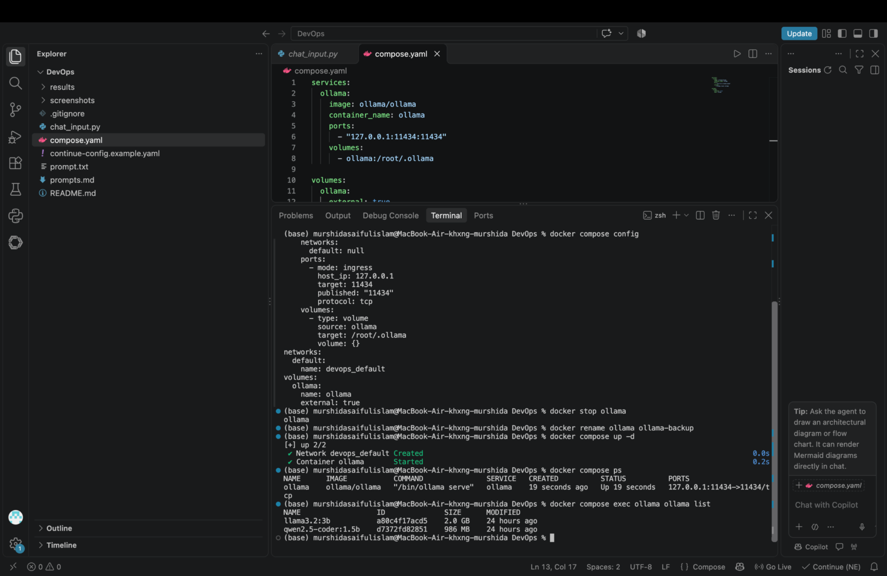
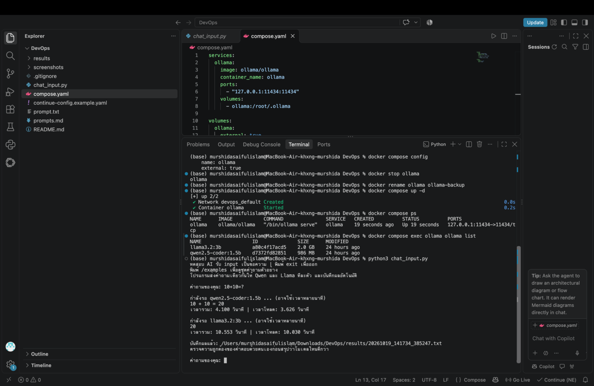
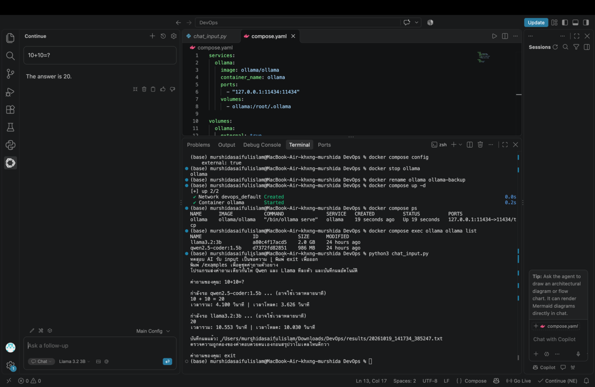
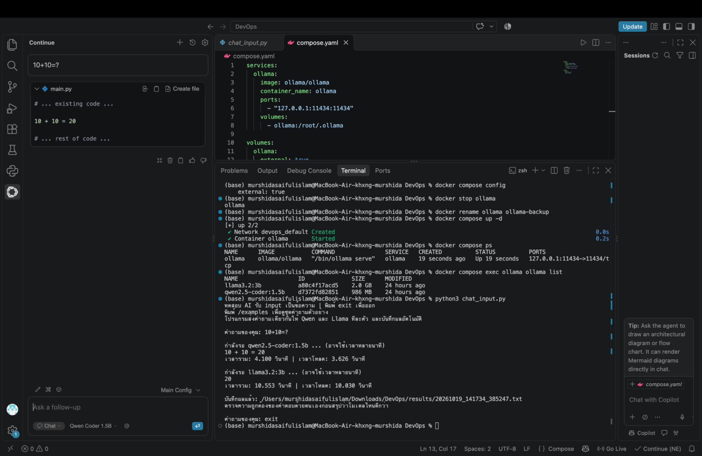

# Local AI และ Agent ด้วย Ollama, Docker Compose และ Python

โปรเจกต์ศึกษาการใช้ AI บนเครื่องส่วนตัว โดยเปรียบเทียบ **Qwen2.5-Coder 1.5B** กับ **Llama 3.2 3B** แล้วต่อยอดจากการถาม–ตอบเป็น Agent ที่เลือกเรียกเครื่องมืออ่านและเขียนไฟล์ พร้อมบันทึกขั้นตอนเพื่อตรวจสอบย้อนหลัง

## ปัญหาและวัตถุประสงค์

การตอบคำถามได้เพียงอย่างเดียวยังไม่แสดงว่า AI ทำงานกับไฟล์หรือทำงานหลายขั้นตอนได้ และคำตอบที่ดูมั่นใจอาจมีข้อมูลผิด จึงต้องทดลองทั้งคุณภาพคำตอบ เวลา และการเรียกเครื่องมือจริง ขอบเขตงานตามที่ผู้จัดทำยืนยันจากคำสั่งอาจารย์คือใช้ Docker เท่านั้น โดยรัน Ollama โมเดล และโปรแกรมสาธิตใน container

1. สร้างสภาพแวดล้อม Docker ด้วยไฟล์กำหนดค่าที่นำไปใช้ซ้ำได้
2. เปรียบเทียบสองโมเดลด้วยคำถามและค่าตั้งเดียวกัน พร้อมเก็บคำตอบเดิม
3. สาธิต Agent รับโจทย์ → เลือกเครื่องมือ → อ่านผล → ทำขั้นถัดไป → สรุปงาน
4. ทดสอบการเรียกโมเดลใน Docker จาก Terminal และ Continue ใน VS Code
5. แสดงหลักฐานติดตั้งโมเดลและรัน Agent ใน Docker พร้อมเก็บผลผ่าน volume และ bind mount

## สถานะหลักฐาน

| ส่วน | สิ่งที่มีในชุดนี้ | ข้อจำกัด |
|---|---|---|
| เปรียบเทียบโมเดล | ผลเดิมที่อ่านได้ 12 รอบ รวม 24 คำตอบ จาก 8 คำถามไม่ซ้ำ | มี JSON ว่าง 1 ไฟล์ และ Qwen ถูกตัดคำตอบ 2 รอบ |
| Docker + Python | ตรวจ runtime ใหม่และถาม 10+10 ผ่านทั้งสองโมเดลใน [environment-docker.json](evidence/environment-docker.json) | ผลเดิมยังแยกจากรอบตรวจใหม่ |
| Continue | ตัวอย่าง config และภาพสองโมเดลใน Chat | ยังไม่มีหลักฐานเรียกเครื่องมือผ่าน Continue Agent |
| Agent local | Qwen + structured JSON ผ่าน 7 checks ทั้ง [ใน container](agent_results/20261019_190946_794703.json) และ [Python บน Mac → Docker](agent_results/20261019_190955_157226.json) | native tool calling และ Llama JSON ยัง incomplete ดูผลทุกรอบด้านล่าง |
| การติดตั้งโมเดลใน Docker | มีรายชื่อโมเดล digest และผลเรียกใช้ทั้งสองโมเดลใน [environment-docker.json](evidence/environment-docker.json) | ตรวจตามขอบเขต Docker ที่ผู้สอนกำหนด |
| MCP | initialize, tools/list, เขียน–อ่านไฟล์จริง และปฏิเสธ path traversal ผ่านใน [mcp-probe.json](evidence/mcp-probe.json) | เป็นการตรวจ MCP แยกจาก Agent หลัก |

ดู [สถาปัตยกรรม](docs/ARCHITECTURE.md), [รายการก่อนส่ง](docs/SUBMISSION-CHECKLIST.md) และ [สารบัญผลเดิม](results/README.md) การมีโค้ดหรือคำสั่งในเอกสารยังไม่เท่ากับมีหลักฐานทดสอบสำเร็จ

## การออกแบบระบบ

เส้นทางสาธิตหลัก: Terminal → Docker Compose → โปรแกรม compare/Agent ใน container → `http://ollama:11434` → Ollama ใน Docker → โมเดลใน volume `ollama`

การเชื่อมต่อจากภายนอก: Continue ใน VS Code → `localhost:11434` → Ollama ใน Docker โดย VS Code เป็น client และโมเดลยังทำงานใน container

Agent ใช้ `/api/chat` และค่าเริ่มต้น `--protocol json` เพื่อให้โมเดลเลือก action สำหรับ `list_files`, `read_file` และ `write_file` แล้วส่งผลเครื่องมือกลับไปให้โมเดลทำงานต่อ มี `--protocol native` สำหรับทดลอง native tool calling แยกต่างหาก งานสาธิตอ่าน `notes.txt` แล้วสร้างและตรวจ `checklist.md` ในโฟลเดอร์เฉพาะของรอบนั้น ดูแผนภาพใน [ARCHITECTURE.md](docs/ARCHITECTURE.md)

## เครื่องมือและไฟล์

เครื่องทดลองเดิม: MacBook Air ชิป Apple M4, RAM 16 GB ตามข้อมูลผู้จัดทำ ผลเดิมไม่ได้เก็บ metadata ครบ จึงไม่รับรองว่าเครื่องอื่นจะได้เวลาเท่ากัน

รอบตรวจใหม่วันที่ 19 ตุลาคม 2026 บันทึก Docker Desktop **4.67.0**, Docker Engine **29.3.1**, Compose **v5.1.1**, Ollama **0.40.6** พร้อม model digest และ quantization ของทั้งสองโมเดลไว้ใน [environment-docker.json](evidence/environment-docker.json) ข้อมูลนี้เป็นสถานะตอนตรวจใหม่ ไม่ได้ใช้ยืนยันเวอร์ชันย้อนหลังของผลเดิม

| ไฟล์/โฟลเดอร์ | หน้าที่ |
|---|---|
| `compose.yaml` | กำหนด Ollama และบริการทางเลือกสำหรับ compare, Agent และ MCP |
| `Dockerfile`, `Dockerfile.mcp` | สร้างอิมเมจโปรแกรม Python และ MCP |
| `chat_input.py` | ส่งคำถามเดียวกันให้ Qwen และ Llama แล้วบันทึกผล |
| `local_agent.py` | วงรอบให้โมเดลเลือกเครื่องมือและรับผลกลับ |
| `workspace_tools.py` | เครื่องมือจัดการไฟล์ภายในขอบเขต workspace |
| `mcp_server.py` | เปิดเครื่องมือชุดเดียวกันผ่าน MCP แบบ stdio เมื่อเลือกใช้ |
| `prompts.md` | คำถามจริงครบทั้ง 8 แบบและโจทย์สาธิตใหม่ |
| `continue-config.example.yaml` | ตัวอย่างตั้งค่า Continue โหมด Chat |
| `continue-mcp.example.yaml` | ตัวอย่างเพิ่ม MCP ให้ Continue ต้องแทน absolute path ก่อนใช้ ยังไม่ใช่ผลทดสอบ Agent UI |
| `results/` | ผลเปรียบเทียบเดิม JSON/TXT และข้อจำกัดของผล |
| `agent_results/` | log JSON/TXT ของ Agent ทั้งรอบผ่านและรอบไม่ครบ |
| `agent_workspace/` | โฟลเดอร์งานแยกตามรอบของ Agent |
| `mcp_workspace/` | พื้นที่ไฟล์สำหรับ MCP แยกจากงาน Agent |
| `screenshots/` | ภาพหลักฐานเดิมและคำอธิบาย |
| `docs/` | สถาปัตยกรรมและรายการตรวจส่งงาน |
| `evidence/` | metadata ของ runtime และผลตรวจ Docker/MCP ใหม่ |
| `scripts/` | ตรวจ runtime, probe MCP และรันชุดตรวจ Agent บน Docker |
| `prompt.txt` | โจทย์ต่อยอดเว็บ To-do List; ยังไม่ใช่ผลสร้างเว็บสำเร็จ |

## เริ่มใช้ Ollama ใน Docker

ติดตั้ง [Docker Desktop](https://www.docker.com/products/docker-desktop/) แล้วเปิด Docker Desktop ก่อน โปรแกรม Python สำหรับสาธิตอยู่ใน image จาก Terminal ในโฟลเดอร์โปรเจกต์:

```bash
docker --version
docker compose version
docker compose config
```

Compose ใช้ volume ภายนอกชื่อ `ollama` เครื่องที่ยังไม่มีให้สร้างก่อน คำสั่งนี้ใช้ volume ที่มีอยู่ได้:

```bash
docker volume create ollama
docker compose up -d ollama
docker compose ps
docker compose exec ollama ollama list
```

หากขาดโมเดล ให้ดาวน์โหลดขณะเชื่อมอินเทอร์เน็ต:

```bash
docker compose exec ollama ollama pull qwen2.5-coder:1.5b
docker compose exec ollama ollama pull llama3.2:3b
```

โมเดลเก็บใน Docker volume ไม่ได้รวมอยู่ใน GitHub หลังดาวน์โหลดแล้วงานสาธิตเรียกโมเดลและเครื่องมือในเครื่อง โดยไม่ใช้ cloud model/API key

หากมีคอนเทนเนอร์ `ollama` จาก `docker run` ใช้ชื่อหรือพอร์ตเดียวกัน ให้ตรวจของเดิมก่อนเปิด Compose ไม่ต้องลบ volume เพื่อย้ายระบบ ดู [การย้ายคอนเทนเนอร์เดิม](#ย้ายจากคอนเทนเนอร์เดิมครั้งเดียว)

## เปรียบเทียบคำตอบสองโมเดล

```bash
docker compose --profile tools run --build --rm compare
```

พิมพ์คำถามแล้วกด Enter โปรแกรมเรียก Qwen ก่อน Llama และบันทึกใน `results/` ทีละโมเดล พิมพ์ `/examples` เพื่อดูตัวอย่าง หรือ `exit` เพื่อออก แต่ละคำถามไม่มีประวัติสนทนาข้ามรอบ โปรแกรมรับข้อความทีละบรรทัดและไม่ได้อ่าน `prompt.txt` อัตโนมัติ

## สาธิต Agent ผ่านโมเดลใน Docker

รันโปรแกรม Agent และโมเดลใน Docker ผ่านบริการ profile `tools`:

```bash
docker compose --profile tools run --build --rm agent --demo --model qwen2.5-coder:1.5b --protocol json --runtime docker
```

Agent เตรียม `notes.txt` เป็นข้อมูลตั้งต้น โมเดลเป็นผู้เลือกเครื่องมือเพื่ออ่านข้อมูล สร้าง `checklist.md` และตรวจงาน ผลอยู่ใน `agent_results/<run_id>.json` และ `.txt` ส่วนไฟล์งานอยู่ใน `agent_workspace/<run_id>/`

บริการนี้ใช้ `OLLAMA_URL=http://ollama:11434` และ mount ผลออกมาที่โฟลเดอร์โปรเจกต์ Terminal เป็นผู้สั่งงานจากภายนอก container ส่วน Continue เป็นอีกตัวอย่าง client ที่เชื่อมเข้า Docker

ตรวจทั้ง log การเรียกเครื่องมือและเนื้อหาไฟล์จริง การตอบว่า “สร้างแล้ว” อย่างเดียวไม่พอ สำหรับงานอื่นใช้ `--task 'ข้อความโจทย์'` แทน `--demo` และดูตัวเลือกด้วย `docker compose --profile tools run --rm agent --help`

ค่าเริ่มต้นเป็น **Qwen + `--protocol json`** ซึ่งให้โมเดลเลือกหนึ่ง action ต่อรอบผ่าน structured JSON แล้วโปรแกรมเรียกเครื่องมือจริงและส่ง observation กลับให้โมเดลตัดสินใจต่อ ส่วน `--protocol native` ใช้ `tools`/`tool_calls` ของ Ollama และอาจมีหลาย tool calls ในคำตอบเดียว ต้องรายงาน protocol ตาม log แยกผลกัน เพราะผลทดสอบสองรูปแบบไม่เหมือนกัน

`--runtime docker` เป็นป้ายบริบทที่ผู้รันระบุ จึงแนบสถานะคอนเทนเนอร์และ endpoint ประกอบ คำว่า `native` ใน `--protocol native` หมายถึงรูปแบบ tool calling ของ Ollama ซึ่งใช้กับโมเดลใน Docker ได้

## MCP ทางเลือก

`mcp_server.py` เปิดเครื่องมือจัดการไฟล์ชุดเดียวกับ Agent ผ่าน stdio สำหรับ MCP client ที่รองรับ โดยใช้พื้นที่ `mcp_workspace/` แยกจากงาน Agent ส่วน `local_agent.py` เรียก Python tools โดยตรง การรัน Agent หลักจึงไม่ได้เป็นหลักฐานว่า client เชื่อมต่อ MCP สำเร็จ

Build server ก่อน แล้วใช้โปรแกรมตรวจที่ทำหน้าที่เป็น MCP client ผ่าน stdio โดยไม่เปิด TTY:

```bash
docker compose build mcp
python3 scripts/probe_mcp.py
```

probe เรียก `initialize`, `tools/list`, `tools/call` เพื่อเขียนและอ่านไฟล์จริง พร้อมตรวจว่า `../outside.txt` ถูกปฏิเสธ ผลที่ตรวจสำเร็จอยู่ใน [mcp-probe.json](evidence/mcp-probe.json)

ถ้าต้องการใช้ MCP client อื่น ให้ตั้ง command `docker`, arguments `compose run --rm --no-deps -T mcp` และ working directory เป็นโฟลเดอร์โปรเจกต์เดียวกับที่ build หากใช้ Compose project name อื่น ต้องระบุ `-p` ให้ตรงทั้ง build และ run ดูขอบเขตไฟล์ใน [ARCHITECTURE.md](docs/ARCHITECTURE.md) เกณฑ์ที่ตรวจไม่ได้ระบุว่าต้องใช้ MCP, CrewAI หรือสร้างเว็บ To-do โดยเฉพาะ

สำหรับ Continue มี [continue-mcp.example.yaml](continue-mcp.example.yaml) ให้แทน `/ABSOLUTE/PATH/TO/DevOps-ready` ด้วยโฟลเดอร์จริงก่อนนำไปใช้ ยังไม่ได้เปลี่ยน config จริงของผู้ใช้หรือทดสอบการเรียก MCP ผ่าน Agent UI

## ผลตรวจ Agent ใหม่

ผลต่อไปนี้แยกจาก 12 รอบถาม–ตอบเดิม ทั้งหมดเรียกโมเดล Ollama ใน Docker ผ่าน local endpoint และเก็บผลไม่ครบไว้ตามจริง:

| Run ID | โมเดล | Protocol | สถานะ | สิ่งที่พบ |
|---|---|---|---|---|
| [19:02:50](agent_results/20261019_190250_185723.json) | Llama | native | incomplete | เรียกเครื่องมือจริง แต่ลำดับอ่านต้นฉบับและเนื้อหา checklist ไม่ผ่าน |
| [19:03:05](agent_results/20261019_190305_604987.json) | Qwen | native | incomplete | พิมพ์ JSON เป็นข้อความ แต่ไม่มี tool call จริง |
| [19:03:52](agent_results/20261019_190352_584807.json) | Llama | json | incomplete | เรียกเครื่องมือ แต่แก้ต้นฉบับและผลไม่ตรงโจทย์ |
| [19:04:11](agent_results/20261019_190411_562205.json) | Qwen | json | passed | อ่านต้นฉบับ → เขียน checklist → อ่านตรวจกลับ ครบ 7 checks |
| [19:07:33](agent_results/20261019_190733_484809.json) | Llama | json | incomplete | อ่าน–เขียนจริง แต่เนื้อหา checklist ไม่ครบตามตัวตรวจ |
| [19:07:49](agent_results/20261019_190749_089298.json) | Qwen | json | incomplete | ไฟล์และ 7 checks ถูกต้อง แต่ช่องคำตอบจบงานว่าง |
| [19:07:58](agent_results/20261019_190758_270216.json) | Qwen บน host | json | incomplete | ไฟล์ถูกต้อง แต่ช่องคำตอบจบงานว่าง |
| [19:09:46](agent_results/20261019_190946_794703.json) | Qwen ใน container | json | passed | รุ่นสุดท้าย อ่าน–เขียน–ตรวจกลับ และมีคำตอบจบงาน ครบ 7 checks |
| [19:09:55](agent_results/20261019_190955_157226.json) | Qwen บน host | json | passed | Python บน Mac เรียกโมเดลใน Docker สำเร็จ ครบ 7 checks |

ชุดตรวจใช้ Terminal เรียก Agent ใน container ชั่วคราว โดยแชร์ network namespace กับ `ollama` ผ่าน `--network container:ollama` และ mount log/ไฟล์งานออกมาที่โปรเจกต์ รอบสุดท้ายยังรัน Python Agent บน Mac โดยตรงไปที่ `127.0.0.1:11434` สำเร็จด้วย ทั้งสองเส้นทางใช้โมเดลใน Docker และไม่ใช่การใช้ Continue Agent UI

ดู [สารบัญทุก run](evidence/AGENT-RUNS.md), [ไฟล์ที่ Agent สร้างจริง](evidence/demo-success/checklist.md), [ต้นฉบับ](evidence/demo-success/notes.txt) และ [ที่มากับ SHA-256](evidence/demo-success/provenance.json) สำเนามาจาก workspace จริงของรอบผ่านล่าสุด ผลทุกครั้งรวมถึงรอบไม่ผ่านถูกรักษาไว้ รอบพัฒนามีการปรับ prompt/validation จึงไม่ใช้เวลาเหล่านี้เทียบความเร็วโมเดลโดยตรง และการผ่านครั้งหนึ่งไม่รับรองว่าจะถูกทุกครั้ง

[Unit tests 21 ข้อ](evidence/unit-tests.txt) ผ่าน ครอบคลุมการออกนอก workspace การอ่านไฟล์รุ่นสุดท้ายกลับ และกรณีโมเดลอ้างความสำเร็จโดยไม่มีเครื่องมือ โปรแกรมขอให้โมเดลแก้คำตอบเมื่อ `finish` ว่าง โดยไม่เติมคำตอบแทนโมเดล

## ทำซ้ำชุดตรวจ

คำสั่งด้านล่าง build อิมเมจใน Compose project `devops-review` แล้วทดสอบกับคอนเทนเนอร์ `ollama` ที่เปิดและมีโมเดลอยู่แล้ว โดยไม่ต้องเปิด Ollama service ตัวใหม่:

```bash
docker compose -p devops-review build agent mcp
python3 scripts/verify_docker.py --model qwen2.5-coder:1.5b --protocol json
```

สคริปต์เก็บคำสั่ง exit code และ log ใน `evidence/docker-verification-json.json` รวมถึงเรียก MCP probe ด้วย project name เดียวกัน หากต้องการสำรวจ native tool calling ให้ระบุ `--protocol native` และอ่านสถานะแต่ละรอบจริง

`python3 scripts/inspect_runtime.py --help` แสดงตัวเลือกเก็บ metadata ของ Ollama และ Docker ผลตรวจ runtime ที่แนบอยู่ใน [environment-docker.json](evidence/environment-docker.json)

## วิธีทดลองและการอ่านเวลา

ใช้ system prompt เดียวกันว่า “ตอบคำถามเป็นภาษาไทยอย่างชัดเจน กระชับ และถูกต้อง หากไม่ทราบให้บอกว่าไม่ทราบ” และค่าตั้ง `temperature=0`, `seed=42`, `num_ctx=4096`, `num_predict=768`, `stream=false`, `keep_alive=0`

`elapsed_seconds` คือเวลาตั้งแต่ส่งคำขอจนอ่านคำตอบเสร็จ รวมเวลาโหลดโมเดลถ้ามี `load_seconds` และ `total_seconds_ollama` มาจาก Ollama ส่วน `output_tokens` เป็นจำนวนโทเคน ไม่ใช่จำนวนคำภาษาไทย

โปรแกรมไม่มี warm-up และขอ unload หลังตอบ แต่ไม่ได้บังคับ unload ก่อนคำถามแรก หากมีโมเดลโหลดอยู่ก่อน สภาพเริ่มต้นอาจต่างกัน การใช้ seed/temperature เดียวกันไม่ได้รับรองผลเหมือนเดิมทุกสภาพแวดล้อม

ผลเดิมมี `truncated=true` และ `done_reason=length` **2 คำตอบของ Qwen** ในโจทย์ท่องเที่ยว ทั้งคู่ใช้ 768 โทเคน ส่วนอีก 22 คำตอบจบด้วย `stop` คำตอบจบตามปกติไม่ได้รับรองว่าข้อมูลถูกต้อง

## ผลเปรียบเทียบเดิม

วันที่ในชื่อไฟล์ 18–19 ตุลาคม 2026 มีผลอ่านได้ 12 รอบ/24 คำตอบ/8 คำถามไม่ซ้ำ รายการครบและลิงก์ผลแต่ละรอบอยู่ใน [results/README.md](results/README.md) JSON ว่าง `20261019_094041_455894.json` ไม่ถูกนับและคงไว้โดยไม่แก้ข้อมูลต้นฉบับ

ตารางต่อไปนี้เป็น 4 คำถามชุดแรก แต่ละข้อทดสอบ 1 ครั้งต่อโมเดล เวลาหน่วยวินาที:

| คำถาม | Qwen | Llama | การประเมินคำตอบ |
|---|---:|---:|---|
| [10+10](results/20261018_143617_008885.txt) | 1.640 | 3.528 | ทั้งสองตอบ 20 ถูกต้อง |
| [HTML/CSS/JavaScript](results/20261018_144045_981015.txt) | 3.885 | 17.146 | Qwen สั้นและแยกหน้าที่ได้; Llama พูดซ้ำ |
| [CPU/RAM](results/20261018_144142_345545.txt) | 7.178 | 5.656 | Qwen วกวนและเปรียบเทียบคลาดเคลื่อน; Llama อธิบายชัดกว่าแต่ยังไม่ละเอียด |
| [โจทย์แอปเปิล](results/20261018_144208_372172.txt) | 3.106 | 5.315 | ทั้งสองตอบ 10 ลูกถูกต้อง |

รอบเพิ่มเติมประกอบด้วย Docker, image/container, Docker Compose, โจทย์ท่องเที่ยว และการตรวจ `10+10=?` ซ้ำ ผลวันที่ 19 ตุลาคม เวลา 14:17 เป็นรอบตรวจ Compose หนึ่งรอบ และยังมีผลเวลา 17:08 และ 17:09 ภายหลัง

ตัวอย่างข้อผิดพลาดที่ต้องใช้ประกอบการวิเคราะห์:

- [image/container](results/20261019_084251_841095.txt): Qwen พูดซ้ำและไม่ได้อธิบาย container ครบ; Llama กล่าวผิดว่า image เป็นไฟล์ `.dockerfile` และ container เป็นไฟล์ `.docker container` ความหมายที่ถูกต้องคือ image เป็นชุดไฟล์และค่าที่ใช้สร้าง container ส่วน container เป็น instance ของ image ที่นำมารันได้ ([Docker Docs](https://docs.docker.com/get-started/docker-overview/))
- [ท่องเที่ยวรอบ 10:02](results/20261019_100243_560689.txt) และ [17:08](results/20261019_170847_227505.txt): Qwen พูดซ้ำจนถูกตัดและไม่ได้ตอบสามสถานที่ตามโจทย์ ส่วน Llama ยกชื่อสถานที่ได้ แต่รายละเอียดบางแห่งยังต้องตรวจแหล่งข้อมูลก่อนนำไปใช้จริง

การประเมินนี้เป็นการอ่านคำตอบจากชุดเล็ก ไม่ใช่ benchmark อัตโนมัติ และไม่ได้ใช้ข้อมูลท่องเที่ยวจากโมเดลเป็นข้อเท็จจริงอ้างอิง

## ข้อสรุปและข้อจำกัด

จากชุดแรก Llama 3.2 3B เหมาะเป็นตัวเลือกทดลองสำหรับงานอธิบายพื้นฐานภาษาไทย เพราะคำตอบ CPU/RAM ชัดกว่า Qwen ส่วน Qwen รอน้อยกว่า 3 จาก 4 ข้อและตอบคำนวณง่ายได้ถูก แต่ผลเพิ่มเติมแสดงว่าทั้งสองโมเดลยังตอบข้อมูลผิดได้ จึงต้องตรวจเนื้อหาและการทำตามคำสั่งควบคู่กับเวลา

จำนวนคำถามและรอบซ้ำยังน้อย โมเดลมีขนาด/ความยาวคำตอบต่างกัน และรัน Qwen ก่อน Llama เสมอ จึงยังสรุปว่าโมเดลหนึ่งเร็วหรือดีกว่าทุกงานไม่ได้ ผล Agent ใหม่แสดงว่า Qwen แบบ structured JSON ทำโจทย์สาธิตผ่าน ขณะที่อีกสามรอบยังทำไม่ครบ จึงต้องวิเคราะห์แยกจากผลถาม–ตอบโดยดูการใช้เครื่องมือและไฟล์จริง ยังไม่มีผลสร้างเว็บจาก `prompt.txt` หรือผลทดสอบข้ามเครื่องผ่าน Wi-Fi

งานต่อไปคือทดสอบซ้ำอย่างน้อย 3 รอบต่อโจทย์ แยกแบบโหลดโมเดลไว้แล้วกับแบบต้องโหลด บันทึกเวอร์ชัน/digest/ทรัพยากรครบ และตรวจ Agent ทั้งกรณีสำเร็จและกรณีโมเดลเรียกเครื่องมือไม่ถูกต้อง

## Continue ใน VS Code

ใช้ตัวอย่าง `continue-config.example.yaml` กับส่วนเสริม Continue โดยสำรอง local config เดิมก่อน คัดลอกค่าที่ต้องการไปยัง config จริง เปิดแชทใหม่ แล้วเลือกโมเดลในโหมด **Chat** ตัวอย่างใน repository ไม่เปลี่ยน config บนเครื่องให้อัตโนมัติ

หลักฐานเดิมแสดง Llama ตอบ “The answer is 20.” และ Qwen แสดงคำตอบในกรอบ `main.py` พร้อมข้อความส่วนเกิน ยังไม่มีหลักฐานกดสร้างไฟล์จากกรอบคำตอบและไม่มีเวลาที่วัดจาก Continue ดู [รายละเอียดภาพ](screenshots/README.md)

บทบาท `chat` ในตัวอย่างไม่ได้ยืนยันการใช้เครื่องมือผ่าน Agent UI หากวัดเวลาจาก Continue ให้แยกจากตาราง Python พร้อมบันทึกโมเดล โหมด และสภาพ warm-up

## แนวทางนำเสนอ

1. อธิบายปัญหาและเปิดแผนภาพ: Agent เชื่อม Ollama ภายในเครือข่าย Docker อย่างไร
2. แสดง Compose, รายชื่อโมเดล และถามโจทย์เดียวกันผ่านบริการ compare ใน Docker
3. เปิด JSON/TXT เดิม เปรียบเทียบคำตอบที่ถูก/ผิด เวลาโหลด และตัวอย่างคำตอบถูกตัด
4. รัน Agent แล้วเปิด log การเลือกเครื่องมือพร้อม `checklist.md` ที่สร้างจริง
5. แสดงการเก็บโมเดลใน volume และผลทดลองใน bind mount
6. แสดง Continue Chat และสรุปข้อจำกัด หลีกเลี่ยงอ้างว่าส่วนที่ยังไม่มีหลักฐานผ่านแล้ว

## แก้ปัญหาและคำสั่งประจำ

| อาการ/งาน | วิธีตรวจ |
|---|---|
| ติดต่อ Docker Ollama ไม่ได้ | เปิด Docker Desktop; `docker compose up -d ollama`; `docker compose ps` |
| ไม่พบโมเดล | `docker compose exec ollama ollama list` แล้ว pull เฉพาะโมเดลที่ขาด |
| พอร์ต/ชื่อซ้ำ | ตรวจคอนเทนเนอร์เดิมที่ใช้ชื่อหรือพอร์ตเดียวกันก่อนเปิดเพิ่ม |
| Agent ไม่ผ่าน | ดู log รอบนั้น, protocol, ข้อผิดพลาดเครื่องมือ และไฟล์จริง |
| คำตอบไม่จบ | ดู `truncated`; ถ้าปรับ `num_predict` ให้ทำเหมือนกันทั้งสองโมเดลและแยกรอบใหม่ |
| ดู log Docker | `docker compose logs --tail 50 ollama` |
| หยุดระบบ | `docker compose stop` |

### ย้ายจากคอนเทนเนอร์เดิมครั้งเดียว

สำหรับกรณีเคยสร้าง `ollama` ด้วย `docker run` เท่านั้น ตรวจพื้นที่เก็บเดิมก่อน:

```bash
docker inspect ollama --format '{{range .Mounts}}{{println .Type .Name .Destination}}{{end}}'
```

ต้องพบ `volume ollama /root/.ollama` หากไม่ตรงให้ปรับการอ้างอิง volume ก่อน เมื่อไม่มีคำขอ AI กำลังทำงาน ให้รันทีละคำสั่งและหยุดหากมี error:

```bash
docker stop ollama
docker rename ollama ollama-backup
docker compose up -d ollama
docker compose ps
docker compose exec ollama ollama list
```

`ollama-backup` เป็นคอนเทนเนอร์เดิมที่หยุดไว้และใช้ volume เดียวกัน ไม่ใช่ข้อมูลโมเดลสำรองแยกชุด อย่าเปิดพร้อมตัวใหม่ หากต้องย้อนกลับ ให้หยุดและนำคอนเทนเนอร์ Compose ออกก่อน:

```bash
docker compose down
docker rename ollama-backup ollama
docker start ollama
```

## ภาพหลักฐานเดิม









ภาพเหล่านี้เป็นหลักฐานเดิม ส่วน Agent และ MCP ที่เพิ่มภายหลังมี log ผลตรวจอยู่ใน `agent_results/` และ `evidence/`

## แหล่งอ้างอิง

- [Docker Compose](https://docs.docker.com/compose/intro/compose-application-model/) และ [volumes](https://docs.docker.com/reference/compose-file/volumes/)
- [Docker: image และ container](https://docs.docker.com/get-started/docker-overview/)
- [Ollama Docker](https://docs.ollama.com/docker) และ [Generate API](https://docs.ollama.com/api/generate)
- [Ollama tool calling](https://github.com/ollama/ollama/blob/main/docs/capabilities/tool-calling.mdx)
- [Ollama FAQ: host และพื้นที่เก็บโมเดล](https://docs.ollama.com/faq)
- [Continue config](https://docs.continue.dev/reference)
- [Model Context Protocol architecture](https://modelcontextprotocol.io/docs/learn/architecture)

เอกสารนี้แยกข้อมูลจากผลเดิมออกจากสิ่งที่ต้องทดลองใหม่ และไม่แก้คำตอบหรือเวลาต้นฉบับ
