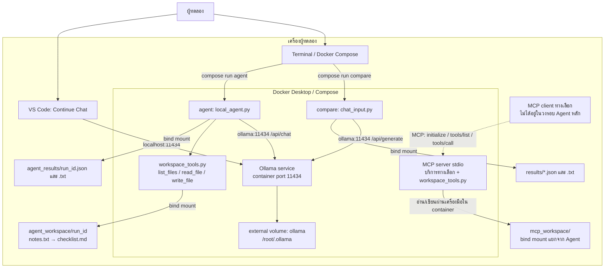
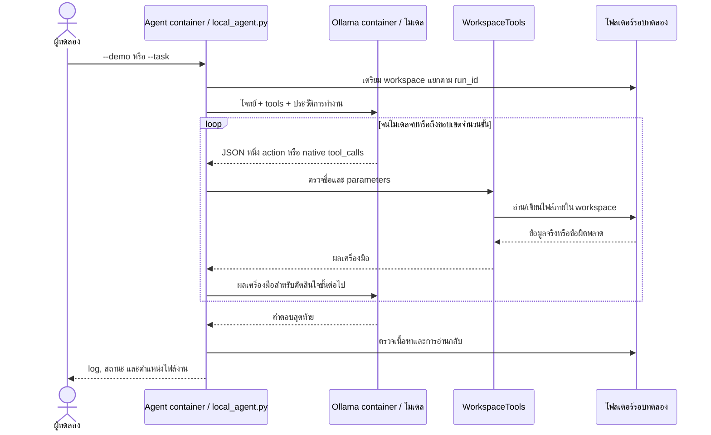

# สถาปัตยกรรมและการไหลของงาน

## ขอบเขตระบบ

ระบบรัน Ollama โมเดล โปรแกรม compare และ Agent ใน Docker ตามขอบเขตที่ผู้จัดทำยืนยันจากคำสั่งอาจารย์ Terminal ใช้สั่ง Compose ส่วน Continue ใน VS Code เป็น client ภายนอกที่เรียกโมเดลใน container

แผนภาพแสดงโครงสร้างโค้ดและเส้นทางที่ออกแบบไว้ สถานะทดสอบแต่ละเส้นทางต้องดูจากหลักฐานรันจริง บริการ `compare`, `agent`, `mcp` ใช้ profile `tools` เพื่อเลือกเรียกตามงาน และ mount ไฟล์ผลออกมาเก็บบนเครื่อง

## ที่อยู่และพื้นที่เก็บ

| เส้นทาง | ผู้เรียกใช้ endpoint | ที่อยู่ | พื้นที่เก็บโมเดล |
|---|---|---|---|
| Client ภายนอก | Continue หรือ Python client ตามหลักฐานเดิม | `http://localhost:11434` | Docker volume `ollama` |
| Docker จากบริการ Compose | Python ใน container | `http://ollama:11434` | Docker volume `ollama` |

`localhost` ภายใน container หมายถึง container ตัวนั้น จึงใช้ชื่อ service `ollama` เมื่อติดต่อข้าม service ใน Compose ส่วนพอร์ตที่ publish บนเครื่องผูกกับ loopback ใช้ทดลองบนเครื่องเดียวกัน ไม่ใช่หลักฐานทดสอบผ่าน Wi-Fi

โมเดลเก็บใน volume `ollama` ที่ mount ไปยัง `/root/.ollama` ภายใน container ส่วน GitHub เก็บโค้ด เอกสาร และหลักฐานผลทดลองโดยไม่รวม weights

## วงรอบ Agent

ค่าเริ่มต้นเป็น Qwen และ `--protocol json` ให้โมเดลเลือกหนึ่ง action เป็น structured JSON ต่อรอบ แล้วโปรแกรมเรียกเครื่องมือจริงก่อนส่ง observation กลับไปให้โมเดล ส่วน `--protocol native` ต้องเลือกโดยระบุเอง ใช้ช่อง `tools` และ `tool_calls` ของ Ollama และอาจคืนหลาย tool calls ในหนึ่งคำตอบ คำว่า native ใน protocol นี้เป็นชื่อรูปแบบ API ที่ใช้กับ Ollama ใน Docker ได้ ทั้งสองกรณีเก็บ protocol ตามจริง ไม่มีการสลับหรือเติมผลสำเร็จแทนโมเดลอย่างเงียบ ๆ

งาน demo มีข้อมูลเริ่มต้น 3 งานใน `notes.txt` โมเดลต้องอ่านไฟล์ สร้าง `checklist.md` และอ่านไฟล์ที่สร้างกลับ การตรวจครอบคลุมว่าต้นฉบับไม่เปลี่ยน มี checkbox ที่ยังไม่ติ๊กครบ 3 ข้อ เรียงและใช้ถ้อยคำตรงต้นฉบับ รวมถึงมี tool trace อ่านต้นฉบับก่อนเขียนและอ่านกลับหลังเขียนจริง การประกาศว่าสำเร็จโดยโมเดลไม่เพียงพอ

Agent เก็บโมเดลโหลดไว้ได้ 5 นาทีระหว่างขั้น (`keep_alive=5m`) ต่างจากโปรแกรมเปรียบเทียบที่ใช้ `keep_alive=0` จึงไม่ควรนำเวลารวมของสองโปรแกรมมาเปรียบเทียบตรง ๆ

## เครื่องมือและขอบเขตไฟล์

| เครื่องมือ | หน้าที่ |
|---|---|
| `list_files` | แสดงไฟล์/โฟลเดอร์หนึ่งระดับภายใน workspace |
| `read_file` | อ่านไฟล์ข้อความ UTF-8 |
| `write_file` | สร้างหรือแทนที่ไฟล์ข้อความ UTF-8 ภายใน workspace |

เครื่องมือจำกัดขนาดข้อความ 32 KiB, ไม่รับ absolute path, `..` หรือ symlink และไม่มีเครื่องมือรัน shell โฟลเดอร์แยกตามรอบช่วยให้ผลเดิมไม่ถูกเขียนทับ นี่เป็นขอบเขตที่โปรแกรมบังคับใช้สำหรับงานไฟล์ ไม่ใช่ sandbox ของระบบปฏิบัติการสำหรับป้องกันโปรเซสอื่นที่แก้ไฟล์พร้อมกัน

ไฟล์งานและข้อความจากเครื่องมือเป็นข้อมูลให้โมเดลอ่าน ไม่ใช่คำสั่งของผู้ทดลอง ข้อความในไฟล์ไม่ควรเปลี่ยนขอบเขตที่โปรแกรมอนุญาต

## หลักฐานที่ควรจับคู่กัน

- log Agent ระบุ endpoint, `runtime_declared`, protocol, โมเดล, metadata จาก `/api/version` และ `/api/show`, tool events และสถานะตรวจงาน
- ไฟล์จริงใน `agent_workspace/<run_id>/` ต้องตรงกับสิ่งที่ log อ้าง
- หลักฐาน Docker ต้องมีสถานะ service และโมเดลใน container ประกอบ

`runtime_declared` เป็นข้อความที่ผู้รันเลือก ไม่ใช่หลักฐาน runtime โดยตัวมันเอง จึงต้องตรวจคู่กับสถานะคอนเทนเนอร์ endpoint และรายชื่อโมเดลจาก Docker

## MCP ทางเลือก

MCP ใช้รูปแบบ client–server และทำให้ client เรียกเครื่องมือที่ server เปิดให้ได้ ([MCP architecture](https://modelcontextprotocol.io/docs/learn/architecture)) ในโปรเจกต์นี้ `mcp_server.py` เปิดฟังก์ชันจาก `workspace_tools.py` ผ่าน stdio แยกจาก Agent หลักซึ่งเรียกฟังก์ชันโดยตรง

มีผลตรวจ MCP แยกจริงใน [mcp-probe.json](../evidence/mcp-probe.json): `initialize`, `tools/list`, `tools/call` เขียน/อ่านไฟล์สำเร็จ และปฏิเสธ path traversal โดย `scripts/probe_mcp.py` เป็น client ผ่าน stdio การตรวจนี้ครอบคลุม MCP server และเครื่องมือไฟล์ ไม่ได้แสดงว่า Agent หลักเรียกผ่าน MCP

## เส้นทางที่ทดสอบจริง

- Python เปรียบเทียบและ Continue Chat บนเครื่องเรียก Docker Ollama ตามผลและภาพเดิม
- รอบตรวจใหม่เรียก Agent จาก Terminal ผ่าน container ชั่วคราว ใช้ `--network container:ollama` เพื่อแชร์ network namespace ของ Ollama แล้ว mount หลักฐานออกมาที่โปรเจกต์ Qwen แบบ JSON ใน [รอบ 19:04:11](../agent_results/20261019_190411_562205.json) ผ่านครบ 7 checks
- Native tool calling ของ Llama/Qwen และ JSON ของ Llama มีผล `incomplete` เก็บ log ตามจริงใน `agent_results/` ดูรายละเอียดใน [README](../README.md#ผลตรวจ-agent-ใหม่)
- Host Python → Docker endpoint ทดสอบจริงผ่านแล้วใน [รอบ 19:09:55](../agent_results/20261019_190955_157226.json) ส่วน [รอบ container รุ่นสุดท้าย 19:09:46](../agent_results/20261019_190946_794703.json) ผ่านครบ 7 checks เช่นกัน
- ดู [ทุก run](../evidence/AGENT-RUNS.md) และ [ไฟล์ผลจริงพร้อมที่มา](../evidence/demo-success/provenance.json) ซึ่ง export จาก workspace ของรอบผ่าน ไม่ได้สร้างใหม่จากข้อความสรุปของโมเดล
- Continue Agent UI ยังไม่ผ่านการทดสอบ หลักฐานที่มีคือ Continue Chat และ Agent จาก Terminal

## Infrastructure as Code และการทำซ้ำ

Compose กำหนดบริการ เครือข่าย พอร์ต และ volume ส่วน Dockerfile กำหนดโปรแกรมที่นำไป build ร่วมกับโค้ดได้ ผลใหม่ตรวจ config และ build อิมเมจ Agent/MCP ด้วย Compose project `devops-review` แล้วใช้ runtime Ollama ที่เปิดอยู่ ดู [ผลตรวจ Docker](../evidence/docker-verification-json.json) และ [metadata](../evidence/environment-docker.json) โมเดลต้อง pull เข้า Ollama container และไม่ได้อยู่ใน GitHub image tag และ model tag ที่ไม่ตรึง digest อาจเปลี่ยนในภายหลัง จึงควรบันทึกเวอร์ชันและ digest ที่ใช้จริงในแต่ละชุดทดลอง

การรันโมเดล local หลังดาวน์โหลดใช้ endpoint ในเครื่องและเครื่องมือไฟล์ในเครื่อง การติดตั้งโปรแกรม ดึง image และดาวน์โหลดโมเดลยังต้องเชื่อมอินเทอร์เน็ตก่อน งานนี้ยังไม่มีหลักฐานทดสอบถอดเครือข่ายแล้วรันสำเร็จ จึงควรสาธิตเพิ่มหากต้องการอ้างการทำงานแบบ offline ที่ตรวจยืนยันแล้ว
